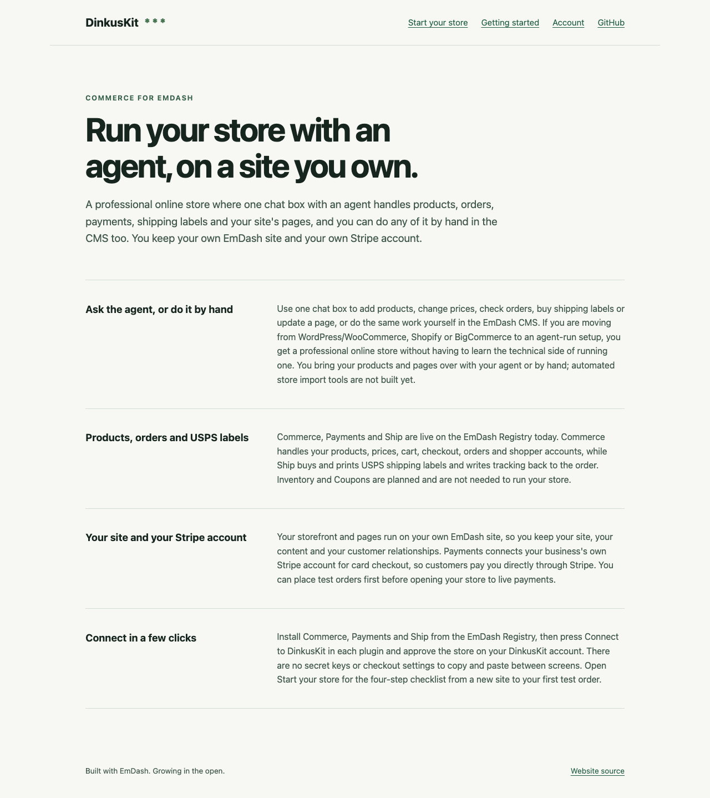
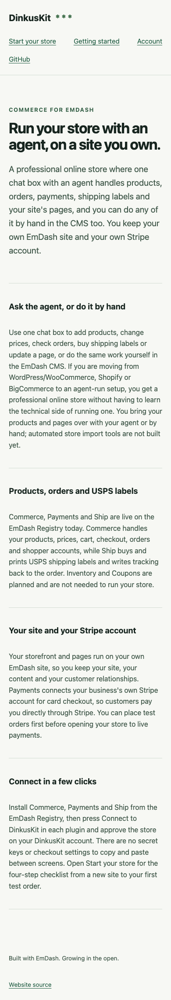

# Home page copy proof (`/` — issue #78)

## What changed

- `seed/seed.json`: rewrote the `pages` entry `home` (`title`, `description`,
  and the four `text_section` items `home-0` through `home-3`) for store owners
  moving to an agent-run store. All home page copy stays in the CMS seed; no
  code-only copy was added to `.astro` templates.
- `scripts/smoke.mjs`: updated the fresh-unseeded and seeded `/` assertions to
  check the new `home` title (`Run your store with an agent, on a site you own.`)
  and first section heading (`Ask the agent, or do it by hand`).
- `DEPLOY.md`: updated the sample-content and post-deploy `/` title checks to
  match the new `home` title.

## Words for the live CMS `home` page (`/_emdash/admin`)

Setup applies `seed/seed.json` only to a new database. On the live
`dinkuskit.com` database, an editor opens `/_emdash/admin`, edits the `pages`
entry `home`, replaces the fields with the words below, and presses **Publish**:

### Page fields

- **Title** (`title`):
  ```text
  Run your store with an agent, on a site you own.
  ```
- **Description** (`description`):
  ```text
  A professional online store where one chat box with an agent handles products, orders, payments, shipping labels and your site's pages, and you can do any of it by hand in the CMS too. You keep your own EmDash site and your own Stripe account.
  ```

### Layout (`layout` — four `text_section` blocks)

1. **`home-0`** (`text_section`)
   - **Heading** (`heading`):
     ```text
     Ask the agent, or do it by hand
     ```
   - **Body** (`body`):
     ```text
     Use one chat box to add products, change prices, check orders, buy shipping labels or update a page, or do the same work yourself in the EmDash CMS. If you are moving from WordPress/WooCommerce, Shopify or BigCommerce to an agent-run setup, you get a professional online store without having to learn the technical side of running one. You bring your products and pages over with your agent or by hand; automated store import tools are not built yet.
     ```

2. **`home-1`** (`text_section`)
   - **Heading** (`heading`):
     ```text
     Products, orders and USPS labels
     ```
   - **Body** (`body`):
     ```text
     Commerce, Payments and Ship are live on the EmDash Registry today. Commerce handles your products, prices, cart, checkout, orders and shopper accounts, while Ship buys and prints USPS shipping labels and writes tracking back to the order (in test mode until live postage opens). Inventory and Coupons are planned and are not needed to run your store.
     ```

3. **`home-2`** (`text_section`)
   - **Heading** (`heading`):
     ```text
     Your site and your Stripe account
     ```
   - **Body** (`body`):
     ```text
     Your storefront and pages run on your own EmDash site, so you keep your site, your content and your customer relationships. Payments connects your business's own Stripe account for card checkout, so customers pay you directly through Stripe. You can place test orders first before opening your store to live payments.
     ```

4. **`home-3`** (`text_section`)
   - **Heading** (`heading`):
     ```text
     Connect in a few clicks
     ```
   - **Body** (`body`):
     ```text
     Install Commerce, Payments and Ship from the EmDash Registry, then press Connect to DinkusKit in each plugin and approve the store on your DinkusKit account. There are no secret keys or checkout settings to copy and paste between screens. Open Start your store for the four-step checklist from a new site to your first test order.
     ```

## Verification

- `./scripts/grilltrack --project . validate` — passed (`valid`).
- `npm run setup && npm run types:wrangler && npm run typecheck && npm run build` — passed (`0 errors, 0 warnings, 0 hints`).
- `npm run test:smoke` — passed:
  - Fresh production workerd before setup does not contain seeded marketing copy.
  - Seeded production workerd renders `/` with `Run your store with an agent, on a site you own.` and `Ask the agent, or do it by hand` inside `[data-native-blocks]`.
- `npm run test:pages-import` — passed.
- `npm run test:docs && npm run test:docs-routes && npm run test:docs-sync` — passed.
- `npm run test:safe-http-url && npm run test:account && npm run test:foundation` — passed.
- `npm run audit:repo` — passed.

## Visual check

Production workerd (`dist/server/wrangler.json`) started against a fresh D1
database seeded from `seed/seed.json`, and headless Chrome captured `/` at two
viewports:

- Desktop (`1280 × 900` viewport, full page): `proof/home-copy/desktop-home.png`
- Phone (`390 × 844` viewport, full page): `proof/home-copy/phone-home.png`

### Desktop (`1280 × 900`)



### Phone (`390 × 844`)


